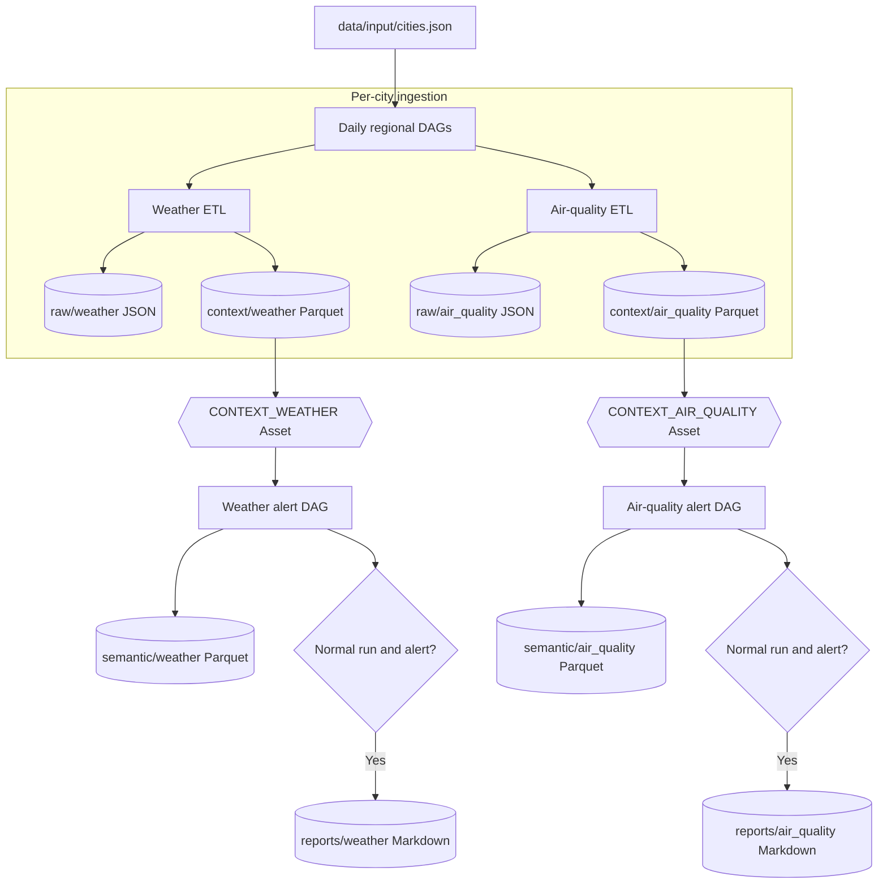

<div align="center">
  <h1>🌦️ Weather and Air Quality Monitor</h1>
  <h3><em>Daily weather and air-quality monitoring for Brazilian cities, powered by Open-Meteo and Apache Airflow.</em></h3>
</div>

<p align="center">
  <a href="https://airflow.apache.org/"></a>
  <a href="https://www.python.org/"></a>
  <a href="https://www.astronomer.io/docs/astro/cli/"></a>
  <a href="https://www.docker.com/"></a>
  <a href="https://open-meteo.com/"></a>
</p>

## Executive Summary

This project collects hourly weather and air-quality forecasts for nine cities across Brazil's South, Southeast, and Northeast regions. Apache Airflow orchestrates ingestion, alert evaluation, and Markdown report generation.

## System Architecture & Technologies

| Component | Role |
| --- | --- |
| Regional Airflow DAGs | Fetch Open-Meteo forecasts and write date-partitioned raw and context data. |
| Airflow Assets | Trigger weather and air-quality alert DAGs when context data is published. |
| Pandas and PyArrow | Transform forecast data into Parquet datasets. |
| Pydantic AI tools | Generate city-level Markdown reports for qualifying alerts. |

### Data Flow - Data Lineage



### Technical Decisions

- Generate daily DAGs from `cities.json` to avoid duplicate regional workflows; mapped TaskFlow tasks run the shared ETL for each city.
- Publish context as Airflow Assets to trigger alerts after ingestion; events carry region, date, and backfill metadata.
- Partition raw JSON, context/semantic Parquet, and Markdown reports by date and region for traceable, date-scoped processing.
- Use the Open-Meteo SDK with a one-hour cache and five retries; forecast code does not use the separately declared HTTP connection.
- Alert at **30 °C or higher**; air quality triggers when daily means exceed **15 µg/m³ for PM2.5** or **45 µg/m³ for PM10**.
- Generate AI reports only for qualifying alerts on normal runs; backfills update semantic data, and short-circuit tasks skip empty reports.
- Schedule DAGs daily and configure two task retries.

## Project Structure

```text
.
├── dags/
│   ├── openmeteo_handler.py
│   ├── issue_temp_alert_report.py
│   └── issue_air_quality_report.py
├── include/openmeteo/        # etl.py, assets.py, agents/prompts/, agents/tools/
├── data/
│   ├── input/cities.json
│   ├── raw/
│   │   ├── weather/year=YYYY/month=MM/day=DD/<region>_<city>_<hour>.json
│   │   └── air_quality/year=YYYY/month=MM/day=DD/<region>_<city>_<hour>.json
│   ├── context/
│   │   ├── weather/year=YYYY/month=MM/day=DD/<region>_<city>.parquet
│   │   └── air_quality/year=YYYY/month=MM/day=DD/<region>_<city>.parquet
│   ├── semantic/
│   │   ├── weather/year=YYYY/month=MM/day=DD/region=<region>/weather_alerts.parquet
│   │   └── air_quality/year=YYYY/month=MM/day=DD/region=<region>/air_quality_alerts.parquet
│   └── reports/
│       ├── weather/year=YYYY/month=MM/day=DD/reports/region=<region>/<city>.md
│       └── air_quality/year=YYYY/month=MM/day=DD/reports/region=<region>/<city>.md
└── tests/dags/              # DAG, weather-alert, and air-quality tests
```

## Key Features

- Daily forecasts for nine cities in three Brazilian regions.
- Automated weather and air-quality alert/report workflows.
- Date-partitioned outputs; backfills update data without generating AI reports.

## Local Development Setup

**Prerequisites:** Docker, Astronomer Astro CLI, and network access to Open-Meteo. Configure `WeatherAlert` for AI-generated reports.

Start the local Airflow environment:

```bash
astro dev start
```

Run the test suite:

```bash
astro dev pytest
```

### Test coverage

- DAG imports, tags, retries, and generation of three regional DAGs.
- Temperature threshold, date/region filters, semantic partitions, and Markdown report reads/writes.
- Daily PM2.5/PM10 means and guidelines, date/region filters, partitioned alerts, and air-quality report reads/writes.

The local `airflow_settings.yaml` declares `open-meteo-weather-api`, but ETL
requests use the Open-Meteo Python SDK directly. The HTTP connection is not
required for forecast ingestion.

Stop the environment with `astro dev stop`.

## Project Policies

- [Contributing](CONTRIBUTING.md)
- [Code of Conduct](CODE_OF_CONDUCT.md)
- [Security](SECURITY.md)
- [License](LICENSE)
